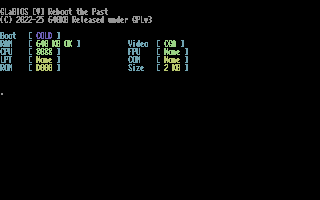
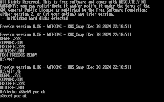

# x86c64 — FreeDOS on a Commodore 64 (POC)

**Proof of concept:** a software 8086/8088-class PC-XT emulator running on
the C64's **6510 CPU**, with actual GLaBIOS POST and a working FreeDOS shell.
The current configuration uses a **Magic Desk cartridge + 1MiB REU + 1581**.
The cartridge contains the emulator and BIOS; FreeDOS lives on the 1581
and sector writes persist in its D81 image.

This is an experimental prototype, validated in **VICE 3.10**. It is very
slow, not cycle accurate, and not a complete PC emulator. Physical C64
hardware and Kung Fu Flash compatibility have not been tested. There is
no ARM coprocessor or host-side x86 execution in the C64 version.

## Actual emulator screenshots

GLaBIOS POST, captured from the production cartridge in VICE:



FreeDOS / FreeCom running from a true-emulated 1581:



These are actual VIC-II pixels captured through VICE's binary monitor,
displayed enlarged here. They are not a recreated PC console. The 80-column
view squeezes the font to 4×8 pixels to fit the C64's 320×200 display.
Use **F1** for the left 40 columns, **F3** for the right 40 columns and
**F5** for all 80 columns. All 25 text rows remain visible.
Font bitmaps: VileR / Oldschool PC Fonts, CC-BY-SA-4.0; the horizontal
reduction is an adaptation. See [attribution](THIRD_PARTY_NOTICES.md).

## Try the prebuilt POC

Get the binary ZIP and its accompanying corresponding-source ZIP from
the [POC release](https://github.com/AidenShaw2020/x86c64/releases/tag/v0.1.0-poc).
The binary ZIP contains `FD64.CRT`, `FD64.D81`, instructions, licenses and
SHA256 manifests. VICE and Commodore ROMs are installed separately.

Use VICE's C64 `x64sc` emulator. From the unpacked binary directory:

```text
x64sc -default -pal -warp +sound -reu -reusize 1024 -drive8type 1581 -drive8truedrive +trapdevice8 -devicebackend8 0 -8 FD64.D81 -cartcrt FD64.CRT
```

On Windows use `x64sc.exe` (or its full path). This opens the emulator visibly.
The equivalent GUI configuration is PAL C64, enabled 1024KiB REU, drive 8
set to 1581 with true-drive emulation enabled, `FD64.D81` attached to drive 8,
and `FD64.CRT` attached as a cartridge. Keep the D81 writable and close VICE
normally to flush pending drive writes. Use a copy for experiments.

**Do not run Commodore `VALIDATE` on this hybrid D81:** it would free the
raw PC volume's reserved blocks. The disk uses 1581 format with a 720KiB
FAT12 volume mapped into its native sectors; it is not a normal PC diskette.
DOS sees it as boot drive `A:`. Details: [1581 backend](docs/1581.md).

## What works

- Actual x86 reset at `FFFF:0000`, GLaBIOS POST, BIOS video and keyboard services.
- 640KiB conventional PC RAM in a 1MiB REU memory map, paged through C64 RAM.
- Booting FreeDOS kernel 2043 and FreeCom 0.86.
- CGA text output with attributes mapped to the C64 palette.
- Keyboard input delivered through emulated IRQ1.
- `VER`, `DIR /B`, `ECHO`, and creating / reading a DOS file on the 1581.
- Persistent 1581 writes, checked in the host D81 after VICE exits.
- Critical CPU and pager paths implemented in 6510 assembly.

The persistence integration test completed with **2,180,551 x86 instructions,
387 sector reads and 5 writes**, with no drive error. It created `WRITE81.TXT`
and verified the exact content after the emulator closed. A subsequent
manual `TYPE WRITE81.TXT` performed new sector reads and displayed the file.
Evidence is in [docs/evidence](docs/evidence), including artifact hashes.

The measured cold start **including DOS commands, file creation/readback
and persistence verification was 766 seconds (12 min 46 sec)** on the
development PC in VICE warp mode. That is a wall-clock test duration,
not the time to the first prompt and not a physical-C64 benchmark.
The older disk-in-REU variant completed its different test in 600.4 seconds.
Microbenchmarks and their limits: [performance](docs/performance.md).

## Limitations

This is an instruction-level interpreter, not a cycle-accurate 8088. PC
peripherals and keyboard coverage are partial; some x86 instructions are
unsupported and stop execution. Compatibility with arbitrary DOS software,
graphics modes, networking, hard-disk booting and MS-DOS has not been
demonstrated. The blank HDD image helper is not a working hard-disk backend.
The IEC disk driver currently uses the standard slow protocol.
Production keyboard input currently sends unshifted XT letter scan codes,
so typed letters appear in lower case; DOS commands are case-insensitive.
Enter commands one at a time and wait for the prompt; a large paste can
overrun the small BIOS keyboard buffer.

Magic Desk banking uses IO1, avoiding the IO2 overlap between EasyFlash RAM
and REU registers. Kung Fu Flash was an early research direction, but the
current POC uses an emulatable cartridge format and an external REU.

## Build and test

The validated development workflow is Windows with Python 3.10+, cc65,
VICE 3.10, JWasm 2.20, Zig 0.14.1 and UPX 4.2.4. It does not require an
external x86 emulator to execute DOS inside the C64.

```powershell
python -B tools/build_glabios.py
python -B tools/prepare_freedos.py
python -B tools/unpack_kernel.py
python -B tools/dev.py build
python -B tools/dev.py prepare-1581
python -B tools/dev.py run-1581
```

`prepare_freedos.py` expects the official hash-checked
`FD14-FloppyEdition.zip` in `build/downloads/`. Tool locations, pinned inputs,
source packages and full reproduction instructions are in
[release/build documentation](docs/release.md).

```powershell
python -B tools/dev.py test
python -B tools/dev.py test-c64-cpu
python -B tools/dev.py test-1581-sectors
python -B tools/dev.py test-1581
```

The last command is a long visible cold-boot test. Native tests exercise
the same interpreter on a development PC, but only VICE tests prove that
the C64 build boots DOS. The production cartridge can also be checked with
`python -B tools/verify_release.py` (requires Pillow), which captures the
screenshots above and verifies a fresh response in actual VIC-II pixels.

## Sources, credits and licenses

Project code: **GPL-2.0-or-later**, [LICENSE](LICENSE). The emulator/BIOS
cartridge is distributed under GPL-3.0-or-later for its program components;
the independently running DOS programs retain their upstream GPL terms.
All component attribution, font terms and runtime notices are listed in
[THIRD_PARTY_NOTICES.md](THIRD_PARTY_NOTICES.md).

Major upstreams are [GLaBIOS](https://github.com/640-KB/GLaBIOS),
[FreeDOS kernel](https://github.com/FDOS/kernel),
[FreeCom](https://github.com/FDOS/freecom),
[cc65](https://github.com/cc65/cc65),
[VICE](https://vice-emu.sourceforge.io/), and
[fddepack](https://hg.pushbx.org/ecm/fddepack/rev/85a255f5048a).
Original notices are preserved. Prebuilt releases supply corresponding
sources alongside binaries. Microsoft DOS and Commodore ROMs are not included.

More: [architecture](docs/architecture.md), [testing](docs/testing.md),
[GLaBIOS configuration](docs/glabios.md), [roadmap](docs/roadmap.md),
[source references](docs/sources.md), and [Czech development notes](docs/development-cs.md).
